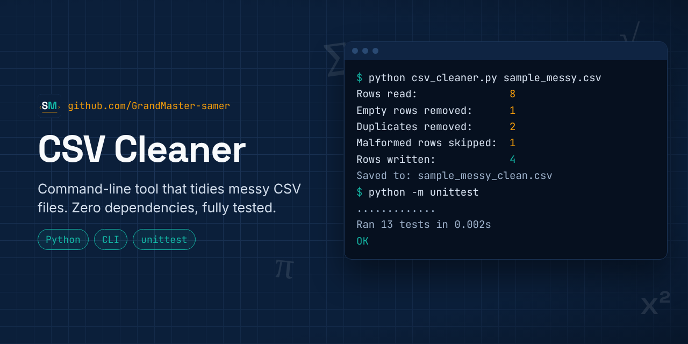

<p align="center"></p>

# CSV Cleaner

<p>


</p>

A small command-line tool written in Python that tidies messy CSV files: it fixes headers, trims cells, removes duplicates and reports what it changed. It uses only the Python standard library, so there is nothing to install.

> This is a command-line tool, so there is no GitHub Pages demo. Clone the repo and run it in about 10 seconds (see **Usage**).

## Demo

```text
$ python csv_cleaner.py sample_messy.csv
Rows read:               8
Empty rows removed:      1
Duplicates removed:      2
Malformed rows skipped:  1
Rows written:            4
Saved to: sample_messy_clean.csv
```

<!-- Optional: record the terminal with asciinema or a GIF and save it as docs/demo.gif -->

## What it does

- Cleans header names: `" Full Name "` becomes `full_name`, `E-mail` becomes `e_mail`
- Trims every cell and collapses repeated spaces
- Turns placeholders such as `N/A`, `null`, `none`, `nan` and `-` into empty cells
- Removes rows that are completely empty
- Removes duplicate rows, or duplicates of the columns you choose (case-insensitive)
- Pads short rows, and skips rows that have more cells than the header
- Prints a short summary of everything it changed

## Usage

Requires Python 3.8 or newer.

```bash
python csv_cleaner.py sample_messy.csv
python csv_cleaner.py sample_messy.csv -o clean.csv --dedupe-by e_mail
```

Without `-o`, the result is saved next to the input as `<name>_clean.csv`. Use the cleaned header names (for example `e_mail`) with `--dedupe-by`. When several rows are duplicates, the first one is kept.

### Example

Input (`sample_messy.csv`, all data is made up):

```
 Full Name ,E-mail,City , Phone
  Rami   Khoury , rami@example.com ,Beirut,N/A
Layla Haddad,layla@example.com,  Zahle ,70 000 001
Rami Khoury,rami@example.com,Beirut,-
,,,
...
```

Output:

```
Rows read:               8
Empty rows removed:      1
Duplicates removed:      2
Malformed rows skipped:  1
Rows written:            4
```

## Run the tests

```bash
python -m unittest -v
```

The tests in `test_csv_cleaner.py` cover headers, cell cleaning, duplicates, short and long rows, files with a byte-order mark, and error handling.

## Files

| File | Purpose |
| --- | --- |
| `csv_cleaner.py` | The tool |
| `test_csv_cleaner.py` | Automated tests |
| `sample_messy.csv` | Made-up sample data to try it on |

## What I learned

- Writing a clean CLI with `argparse`, with helpful errors and exit codes.
- Handling real-world CSV problems: byte-order marks, ragged rows and placeholder values.
- Test-driven fixes with `unittest`, covering edge cases before changing behaviour.

## License

MIT. See [`LICENSE`](LICENSE).

---

Built by [Samer Monzer](https://github.com/GrandMaster-samer) · [LinkedIn](https://www.linkedin.com/in/samer-monzer-51266727a)
